# 📱 Project Mobile — Expense Tracker App

Ứng dụng quản lý tài chính cá nhân được xây dựng bằng **Flutter**, **Riverpod**, **Firebase Authentication** và **Cloud Firestore (ORM Document)**.

---

## 📋 Trả lời Câu 1 – Câu 10

### Câu 1 — User stories (21/21 đã hoàn thành)

1. Là khách, tôi có thể đăng ký tài khoản bằng email.
2. Là người dùng, tôi có thể đăng nhập bằng email và mật khẩu.
3. Là người dùng, tôi có thể yêu cầu gửi email đặt lại mật khẩu.
4. Là người dùng, tôi có thể đăng xuất khỏi ứng dụng.
5. Là người dùng, tôi có thể tạo ví mới.
6. Là người dùng, tôi có thể đổi tên ví.
7. Là người dùng, tôi có thể xoá ví.
8. Là người dùng, tôi có thể xem tổng số dư của tất cả ví.
9. Là người dùng, tôi có thể thêm giao dịch chi.
10. Là người dùng, tôi có thể thêm giao dịch thu.
11. Là người dùng, tôi có thể thêm giao dịch chuyển khoản giữa hai ví.
12. Là người dùng, tôi có thể sửa giao dịch đã ghi.
13. Là người dùng, tôi có thể xoá giao dịch đã ghi.
14. Là người dùng, tôi có thể xem giao dịch theo tháng.
15. Là người dùng, tôi có thể lọc giao dịch theo danh mục.
16. Là người dùng, tôi có thể lọc giao dịch theo loại.
17. Là người dùng, tôi có thể tạo danh mục mới.
18. Là người dùng, tôi có thể đặt hạn mức chi tiêu tháng cho một danh mục.
19. Là người dùng, tôi có thể nhận cảnh báo khi chi vượt hạn mức.
20. Là người dùng, tôi có thể xem biểu đồ chi tiêu theo danh mục.
21. Là người dùng, tôi có thể xem biểu đồ thu chi sáu tháng.

Chi tiết đầy đủ: [docs/Cau-1-2-Phan-Tich-Yeu-Cau.md](docs/Cau-1-2-Phan-Tich-Yeu-Cau.md).

### Câu 2 — Đối tượng, quan hệ và phương thức hoạt động

Năm đối tượng chính, mỗi đối tượng là một lớp Dart trong `lib/data/firestore/models/`:

| Đối tượng | Trường chính | Phương thức chính |
| --- | --- | --- |
| `AppUser` | id, email, displayName, currencyCode, createdAt | `fromDocument`, `toDocument` |
| `Wallet` | id, userId, name, type (`cash`/`bank`/`ewallet`), balance, iconCode, colorHex, createdAt | `fromDocument`, `toDocument`, `copyWith`; repository có `updateBalance(delta)` |
| `Category` | id, name, type (`income`/`expense`), iconCode, colorHex, isDefault | `isExpense`, `isIncome`, `copyWith` |
| `Transaction` | id, userId, walletId, categoryId, type (`income`/`expense`/`transfer`), amount (>0), date, note, toWalletId | `isExpense`, `isIncome`, `isTransfer`, `copyWith` |
| `Budget` | id, userId, categoryId, month, year, limitAmount | `copyWith`, tra cứu theo bộ ba `(categoryId, month, year)` |

**Quan hệ giữa các đối tượng:**

- `AppUser` 1 – n `Wallet`, 1 – n `Transaction`, 1 – n `Budget` (qua trường `userId`).
- `Wallet` 1 – n `Transaction` (qua `walletId`); giao dịch chuyển khoản tham chiếu thêm ví nhận qua `toWalletId`.
- `Category` 1 – n `Transaction` và 1 – n `Budget` (qua `categoryId`).

**Phương thức hoạt động:** giao diện chỉ gọi provider; provider gọi repository (interface có bản Firestore và bản mock); repository mới là nơi ghi Firestore. Ví dụ thêm giao dịch: `TransactionRepository.insertTransaction()` ghi document rồi gọi `WalletRepository.updateBalance(walletId, delta)` với `FieldValue.increment` để cộng/trừ số dư nguyên tử trên server.

### Câu 3 — Sơ đồ lớp và sơ đồ thuật toán

**Sơ đồ lớp:**

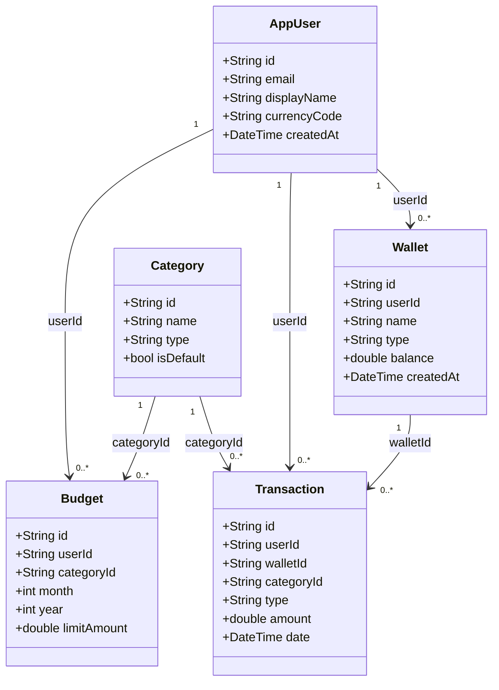

**1. Đăng nhập:**

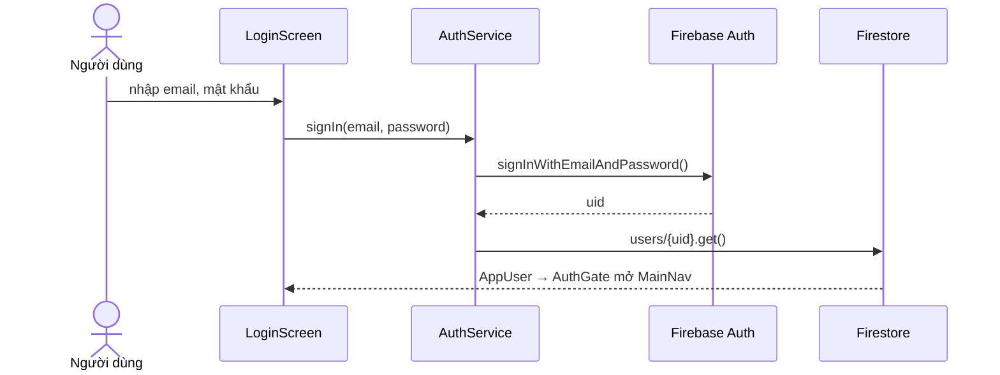

**2. Thêm giao dịch và cập nhật số dư:**

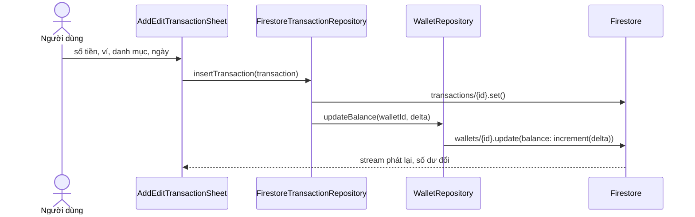

**3. Đặt ngân sách và cảnh báo:**

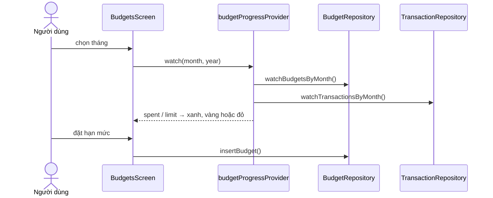

**4. Xem báo cáo:**

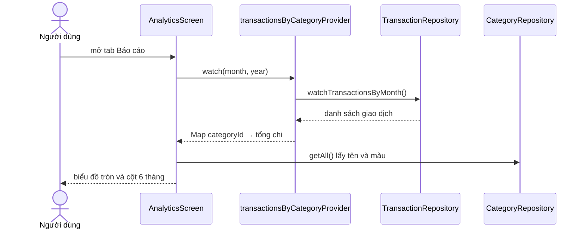

**5. Sửa và xoá giao dịch:**

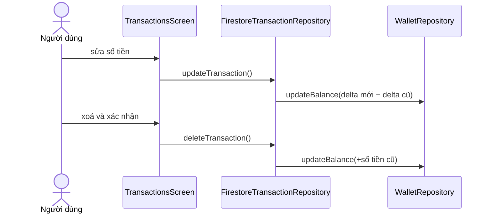

Sơ đồ đầy đủ (kèm sơ đồ điều hướng): [docs/Cau-3-So-Do.md](docs/Cau-3-So-Do.md).

### Câu 4 — Wireframe và luồng công việc

| Màn hình | Bố cục chính | Luồng công việc |
| --- | --- | --- |
| Đăng nhập / Đăng ký | logo, ô email, ô mật khẩu, nút xanh full-width, link Quên mật khẩu và Đăng ký | Đăng nhập → AuthGate → tab 1; Quên mật khẩu → gửi mail, khoá nút 60 giây |
| Ví tiền | thẻ xám tổng số dư, danh sách ví (icon, tên, loại, số dư), nút + | Thêm/sửa trong bottom sheet; xoá có hộp thoại xác nhận |
| Giao dịch | bộ chọn tháng, 3 ô tổng thu–chi–chênh lệch, chip lọc, danh sách nhóm theo ngày, FAB | Thêm/sửa bằng sheet; menu ba chấm có Sửa/Xoá; đổi tháng hoặc bộ lọc thì danh sách đổi theo |
| Danh mục | hai tab Chi tiêu / Thu nhập, danh sách có ổ khoá cho mục mặc định, FAB | Mở từ nút "Quản lý danh mục" ở tab Giao dịch; thêm/sửa/xoá danh mục tự tạo |
| Ngân sách | bộ chọn tháng, thẻ tổng hạn mức, danh sách thanh tiến độ, nút đặt hạn mức | Đặt hạn mức trong bottom sheet; chạm thẻ mở chi tiết để sửa/xoá |
| Báo cáo | bộ chọn tháng, 3 thẻ tổng, biểu đồ tròn có chú giải, biểu đồ cột 6 tháng | Đổi tháng thì số liệu và biểu đồ đổi theo |
| Phiên Đấu Giá | thanh tiêu đề, ảnh sản phẩm, thẻ mã phiên, đồng hồ đếm ngược, bảng lịch sử giá, nút Đặt Giá Nhanh | Bấm đặt giá → giá tăng 100.000, thêm dòng "Bạn"; đồng hồ chạy đến khi hết giờ |

**Bản vẽ wireframe (7 màn):**

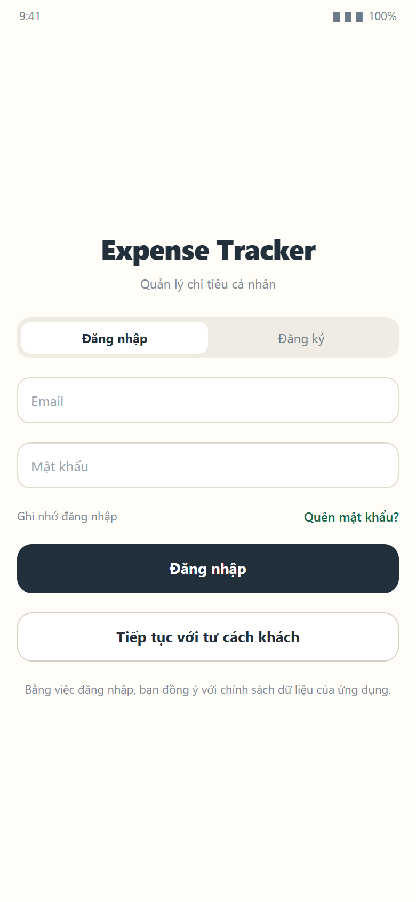

*Hình 1. Màn đăng nhập và đăng ký*

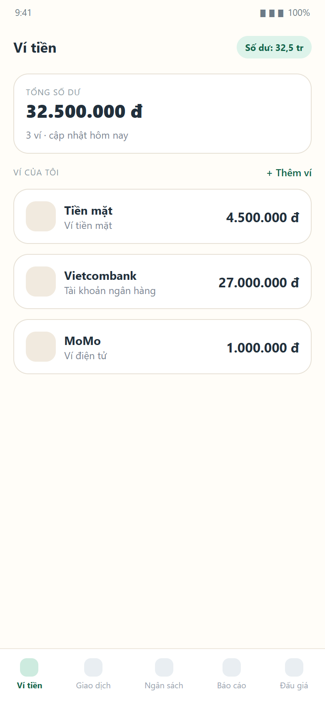

*Hình 2. Tổng quan danh sách ví*

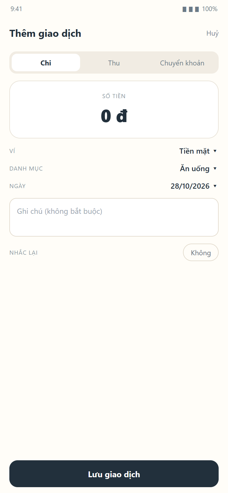

*Hình 3. Thêm giao dịch*

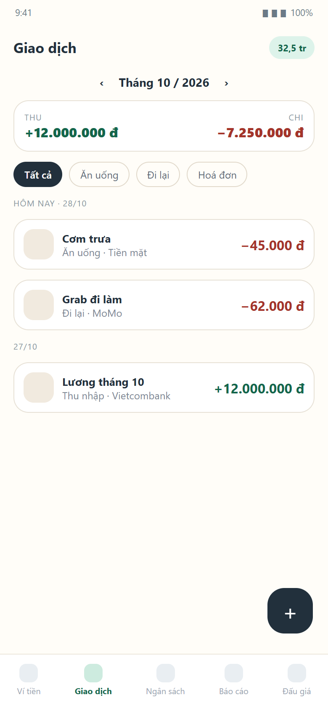

*Hình 4. Danh sách giao dịch theo tháng*

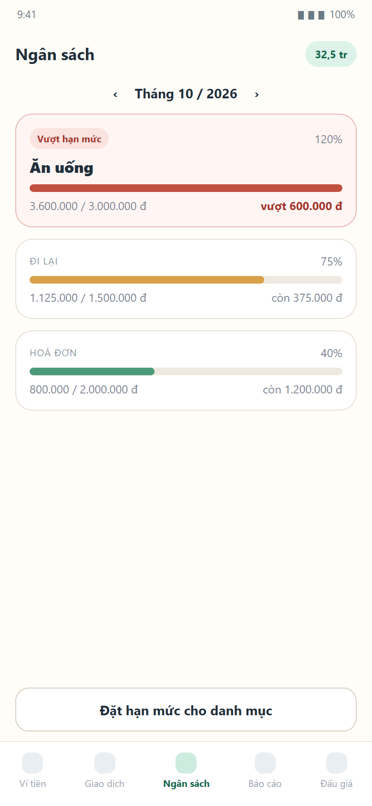

*Hình 5. Ngân sách có cảnh báo vượt hạn mức*

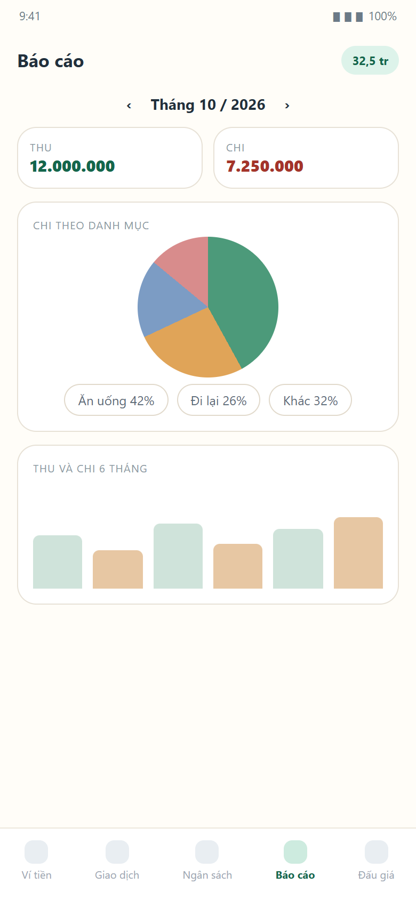

*Hình 6. Báo cáo và biểu đồ*

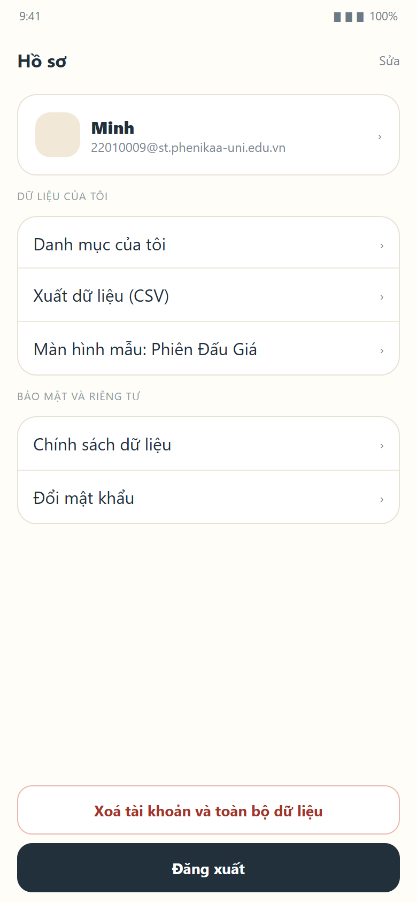

*Hình 7. Hồ sơ và đăng xuất*

### Câu 5 — Màn hình mẫu do giáo viên yêu cầu

Màn **Phiên Đấu Giá** dựng theo ảnh mẫu, trong `lib/features/auction/presentation/auction_session_screen.dart`:

- Thanh tiêu đề xám, ảnh sản phẩm lớn, thẻ thông tin gồm mã phiên và thời gian bắt đầu – kết thúc.
- Đồng hồ đếm ngược dùng `Timer.periodic` mỗi giây, huỷ trong `dispose`; về 0 thì dừng và khoá nút đặt giá.
- Bảng lịch sử trả giá (người đặt, số tiền), nút **Đặt Giá Nhanh** cộng bước giá cố định 100.000 đồng và chèn dòng mới kèm nhãn "Bạn".
- Dữ liệu phiên nằm trong bộ nhớ (màn hình mẫu), không ghi Firestore.

### Câu 6 — Code và logic user story

Kiến trúc ba lớp: **UI → Provider (Riverpod) → Repository → Firestore**. Mỗi feature nằm trong `lib/features/<tên>/`. Số hiệu story khớp với danh sách ở Câu 1 (21 story).

| Story | Nhóm chức năng | Màn hình | Tệp xử lý chính |
| --- | --- | --- | --- |
| US01–US04 | Xác thực và tài khoản | Login, Register, Account | `features/auth/data/auth_service.dart`, `features/auth/providers/auth_providers.dart` |
| US05–US08 | Quản lý ví và tổng số dư | WalletsScreen, AddEditWalletSheet | `features/wallet/data/repositories/firestore_wallet_repository.dart`, `features/wallet/presentation/wallets_screen.dart` |
| US09–US14 | Giao dịch thu, chi, chuyển khoản | TransactionsScreen, AddEditTransactionSheet | `features/transaction/data/repositories/firestore_transaction_repository.dart`, `features/transaction/presentation/add_edit_transaction_sheet.dart` |
| US15–US16 | Lọc giao dịch theo danh mục và loại | TransactionsScreen | `features/transaction/providers/transaction_filter.dart` |
| US17 | Danh mục | CategoriesScreen | `features/category/data/repositories/firestore_category_repository.dart`, `features/category/presentation/categories_screen.dart` |
| US18–US19 | Ngân sách và cảnh báo vượt hạn mức | BudgetsScreen, BudgetDetailScreen | `features/budget/data/repositories/firestore_budget_repository.dart`, `features/budget/data/budget_progress.dart` |
| US20–US21 | Báo cáo và biểu đồ | AnalyticsScreen | `features/analytics/providers/analytics_providers.dart`, `features/analytics/presentation/analytics_screen.dart` |

### Câu 7 — Kết nối CSDL và ORM với Document Firebase

Năm collection phẳng trên Cloud Firestore; ba collection dữ liệu riêng đều mang `userId` và mọi câu đọc lọc `where('userId', isEqualTo: uid)`:

| Đường dẫn | Model | Trường chính |
| --- | --- | --- |
| `users/{uid}` | AppUser | email, displayName, currencyCode, createdAt |
| `wallets/{id}` | Wallet | userId, name, type, balance, createdAt |
| `categories/{id}` | Category | name, type, iconCode, colorHex, isDefault |
| `transactions/{id}` | Transaction | userId, walletId, categoryId, type, amount, date |
| `budgets/{id}` | Budget | userId, categoryId, month, year, limitAmount |

Ánh xạ Document ↔ Object bằng `withConverter` trong `lib/data/firestore/firestore_collections.dart`:

```dart
CollectionReference<Wallet> walletsCollection(FirebaseFirestore db) {
  return db.collection('wallets').withConverter<Wallet>(
        fromFirestore: (snap, _) => Wallet.fromDocument(snap.id, snap.data()!),
        toFirestore: (wallet, _) => wallet.toDocument(),
      );
}
```

`firestore.rules` chặn truy cập chéo: `wallets`, `transactions`, `budgets` yêu cầu `resource.data.userId == request.auth.uid` khi đọc và `request.resource.data.userId == request.auth.uid` khi ghi; `users/{uid}` chỉ chủ tài khoản; `categories` yêu cầu đã đăng nhập.

### Câu 8 — Kiểm thử và kiểm định

`flutter analyze`: không có lỗi. `flutter test`: **105/105 pass**.

| Tệp test | Nội dung | Số test |
| --- | --- | --- |
| `test/generics_test.dart` | Generics, kế thừa, quản lý đa hình | 4 |
| `test/wallet_repository_test.dart` | ORM Wallet, CRUD, `updateBalance` | 7 |
| `test/budget_repository_test.dart` | ORM Budget, tiến độ 80% / vượt / hạn mức 0 | 8 |
| `test/category_repository_test.dart` | ORM Category, CRUD, trùng tên | 13 |
| `test/transaction_repository_test.dart` | ORM Transaction, số dư khi thêm/sửa/xoá, chuyển khoản | 30 |
| `test/category_providers_test.dart` | Provider danh mục | 4 |
| `test/transaction_providers_test.dart` | Bộ lọc và tổng thu chi | 12 |
| `test/category_screen_test.dart` | Màn Danh mục: rỗng, lỗi, thêm/sửa/xoá | 11 |
| `test/transaction_screen_test.dart` | Màn Giao dịch: lọc, form, xoá | 15 |
| `test/widget_test.dart` | Smoke test toàn app | 1 |

- **8a — bắt lỗi:** validator form (email, mật khẩu, số tiền, tên ví, hạn mức) + `try/catch` quanh mọi lệnh Firestore + Security Rules.
- **8b — unit test:** 7 tệp logic (78 test) phủ ORM, repository, provider.
- **8c — kiểm thử toàn app:** smoke test dựng cả ứng dụng; 27 widget test cho màn hình.
- **8d — ca lỗi / thành công:** bảng 16 kịch bản trong báo cáo Chương 5 (sai mật khẩu, email sai định dạng, số dư âm, mất mạng, vượt hạn mức…).
- **8e — kiểm thử giao diện:** chụp 7 màn trên Chrome 430×932, đối chiếu design system xanh lá.

### Câu 9 — Báo cáo, video demo, đóng góp và đạo đức

**Báo cáo** gồm 8 chương: giới thiệu, phân tích yêu cầu, thiết kế, cài đặt, kiểm thử, đạo đức – quyền riêng tư, kết luận, phân công – đóng góp. Bản PDF và bản in nộp theo quy định (Canvas và phòng 2310).

**Video demo:** https://drive.google.com/file/d/1XEXrjKYqCtqPzEfDzv4hWF5rGCuteXlu/view?usp=drive_link (dưới 8 phút).

**Đóng góp:**

| Thành viên | Phần việc chính |
| --- | --- |
| Dương Công Minh (22010009) | Firebase Auth, quản lý ví, tầng ORM Firestore, design system, màn Phiên Đấu Giá, kiểm thử, báo cáo |
| Phạm Hải Đăng (24100454) | Giao dịch thu/chi, danh mục, bộ lọc, test giao dịch – danh mục |
| Đinh Đức Thịnh (24100005) | Ngân sách, cảnh báo hạn mức, biểu đồ báo cáo, test ngân sách |

**Đạo đức và quyền riêng tư dữ liệu** (Chương 6 của báo cáo): ứng dụng chỉ lưu 5 loại dữ liệu cần thiết, không có SDK quảng cáo, không xin quyền vị trí/danh bạ; mật khẩu do Firebase Authentication quản lý. Bối cảnh thảo luận ngày 22/10/2026 — Facebook bị kiện 25 tỷ USD vì vi phạm quyền riêng tư dữ liệu — cho thấy rủi ro pháp lý của dữ liệu cá nhân; nhóm đối chiếu với GDPR và Nghị định 13/2023/NĐ-CP, đồng thời ghi rõ khoảng trống còn lại (chưa có chức năng xoá tài khoản) thay vì tuyên bố đã đáp ứng đầy đủ.

### Câu 10 — Lịch sử commit và chuyên cần

| Tác giả | Số commit (mọi nhánh) | Nhánh chính |
| --- | --- | --- |
| Minhne2194 (Dương Công Minh) | 57 | `feature/leader-auth-wallet-v2` |
| Pham Hai Dang (Phạm Hải Đăng) | 10 | `feature/member2-transaction-category-v2` |
| Đinh Đức Thịnh | 5 | `feature/member3-budget-analytics-v2` |

Commit theo format `feat(scope): mô tả`, mỗi tính năng một commit; nhánh Drift cũ của Member 3 được lưu bằng tag `archive/member3-drift-2026-09`, nhánh cũ của Member 2 vẫn giữ nguyên trên GitHub. Điểm chuyên cần tính theo các buổi thảo luận đầu giờ trên lớp.

---

## 👥 Phân chia công việc theo vai trò

| Thành viên | Trách nhiệm chính | Nhánh Git |
| --- | --- | --- |
| **Member 1 (Leader — Minh, MSSV: 22010009)** | Firebase Auth, Quản lý Ví (`Wallet`), Tầng ORM Firestore (`lib/data/firestore/`), Design System | `feature/leader-auth-wallet-v2` |
| **Member 2 (Hải Đăng, MSSV: 24100454)** | Quản lý Giao dịch (`Transaction`), Danh mục (`Category`) trên Firestore | `feature/member2-transaction-category-v2` |
| **Member 3 (Đinh Đức Thịnh, MSSV: 24100005)** | Quản lý Ngân sách (`Budget`), Báo cáo & Biểu đồ (`Analytics`) trên Firestore | `feature/member3-budget-analytics-v2` |

> 📖 **Tài liệu bắt buộc cho thành viên:**
> - [docs/Huong-Dan-Firestore-Cho-Member.md](docs/Huong-Dan-Firestore-Cho-Member.md) — Hướng dẫn công nghệ Firebase + Firestore + Riverpod + Design System.
> - [docs/Schema-Va-Ban-Giao.md](docs/Schema-Va-Ban-Giao.md) — Schema 5 Collection Firestore & Bảng quy ước Provider chuẩn.

---

## 🛠️ Hướng dẫn bắt đầu cho thành viên nhóm

### 1. Đồng bộ nhánh `develop` mới nhất (đã xóa bỏ hoàn toàn Drift/SQLite cũ)

```bash
git fetch origin
git checkout develop
git pull --ff-only origin develop   # nếu đang có thay đổi chưa commit, commit hoặc stash trước

# Tạo nhánh làm việc mới từ develop sạch (KHÔNG dùng -B, không ghi đè nhánh cũ):
# Dành cho Member 2:
git checkout -b feature/member2-transaction-category-v2

# Dành cho Member 3:
git checkout -b feature/member3-budget-analytics-v2
```

### 2. Tải dependencies & Chạy ứng dụng

```bash
flutter pub get
flutter run -d chrome          # hoặc chạy trên Android Emulator
```

### 3. Chạy kiểm thử (Unit Test & Widget Test)

```bash
flutter test
```

---

## 📁 Cấu trúc thư mục

```text
lib/
├── core/                  # AppColors, theme xanh lá, Firebase providers, widget dùng chung
├── data/
│   └── firestore/         # Tầng ORM với Documents của Firebase Firestore (Câu 7)
│       ├── firestore_collections.dart # CollectionReference<T> gắn sẵn withConverter
│       ├── models/        # 5 đối tượng ORM: AppUser, Wallet, Category, Transaction, Budget
│       └── seed/          # InitialSeeder (13 danh mục thu/chi mặc định, idempotent)
├── entities/              # Lớp Generic và các Model kế thừa tổng quát hóa (OOP)
│   ├── Genericclass.dart  # Lớp Genericclass<T> chuẩn bài giảng
│   ├── generic_class.dart # Export chuẩn snake_case
│   └── project_models.dart# WalletModel, CategoryModel, TransactionModel, BudgetModel
├── features/              # Mỗi feature 3 lớp: Data → Providers → Presentation
│   ├── auth/              # Đăng nhập, Đăng ký, Quên mật khẩu, AuthGate, màn Tài khoản
│   ├── wallet/            # Quản lý ví và số dư trên Firestore + Mock
│   ├── category/          # Danh mục thu/chi
│   ├── transaction/       # Giao dịch thu/chi/chuyển khoản và bộ lọc
│   ├── budget/            # Hạn mức tháng, tiến độ và cảnh báo
│   ├── analytics/         # Báo cáo và biểu đồ fl_chart
│   ├── auction/           # Màn hình Phiên Đấu Giá (Câu 5)
│   ├── main_nav/          # Shell 5 tab, bottom nav có icon
│   └── generics_demo/     # Màn minh họa Generics Output
└── expense.dart           # Expense kế thừa Genericclass<Object>

test/                      # 105 test: ORM, repository, provider, widget
docs/                      # Tài liệu Câu 1–10, wireframe, hướng dẫn thành viên
```

---

## 📚 Báo cáo Bài tập: Generics, Kế thừa & Tổng quát hóa Đối tượng (OOP)

> **Căn cứ tài liệu:** Bài giảng môn Lập trình thiết bị di động — Phenikaa University: *DART : Class - Interface - Inheritance | Class - Abstract Class - Interface - Constructor - Generics*.

### 1. Mục đích (Purpose)
* **Tránh lặp lại mô tả đối tượng (To avoid repetition of Class for objects):** Các thực thể trong ứng dụng Quản lý Chi tiêu (Expense, Ví tiền, Danh mục, Giao dịch, Ngân sách) đều có những thuộc tính cốt lõi chung như mã định danh (`id`), tên gọi (`name`/`title`), và mô tả (`description`).
* **Tổng quát hóa (Generics):** Sử dụng `Genericclass<T>`, `Object class` và `Class class` (Generic Type Parameters & Đa hình) để viết một lần, áp dụng an toàn kiểu cho nhiều đối tượng khác nhau.

---

### 2. Xây dựng đối tượng Generics miêu tả chung các đối tượng trong Project
* **File mã nguồn:** [lib/entities/Genericclass.dart](lib/entities/Genericclass.dart) *(export qua [lib/entities/generic_class.dart](lib/entities/generic_class.dart))*
* **Đặc điểm thiết kế:**
  * Lớp `Genericclass<T>` tổng quát hóa kiểu dữ liệu cho 3 trường cơ sở:
    * `T id;` — Mã định danh đối tượng (có thể là `int`, `String`...).
    * `T name;` — Tên hoặc tiêu đề của đối tượng.
    * `T description;` — Mô tả chi tiết về đối tượng.
  * Cung cấp đầy đủ các phương thức getter & setter: `getId()`, `getName()`, `getDescription()`, `setId()`, `setName()`, `setDescription()`.

```dart
class Genericclass<T> {
  T id;
  T name;
  T description;

  Genericclass({
    required this.id,
    required this.name,
    required this.description,
  });

  T getId() => id;
  T getName() => name;
  T getDescription() => description;

  T setId(T newId) { id = newId; return id; }
  T setName(T newName) { name = newName; return name; }
  T setDescription(T newDescription) { description = newDescription; return description; }
}
```

---

### 3. Kế thừa (extends) & Tổng quát hóa Code trong Bài tập lớn

#### 3.1. Viết lại đối tượng `Expense` đã có trong bài tập thực hành
* **File mã nguồn:** [lib/expense.dart](lib/expense.dart)
* **Kế thừa:** `class Expense extends Genericclass<Object>`
  * Kế thừa `id`, `name`, `description` từ `Genericclass<Object>` qua `super`.
  * Có getter/setter `title` ánh xạ trực tiếp vào `name` để tương thích hoàn toàn mã nguồn cũ.
  * Bổ sung các trường chuyên biệt của bài tập chi tiêu: `amount` (số tiền), `category` (danh mục), `date` (thời gian).
  * Giữ nguyên các phương thức nghiệp vụ: `getFormattedAmount()`, `getExpenseDetails()`, `updateAmount()`.

#### 3.2. Mở rộng các đối tượng trong Bài tập lớn (Project Mobile)
* **File mã nguồn:** [lib/entities/project_models.dart](lib/entities/project_models.dart)
* Tất cả đối tượng nghiệp vụ của nhóm đều kế thừa từ `Genericclass<Object>`:
  1. **`WalletModel` (Leader):** Thêm trường `balance` (số dư), `walletType` (loại ví), phương thức `deposit()`, `withdraw()`, `getFormattedBalance()`.
  2. **`CategoryModel` (Member 2):** Thêm trường `type` (thu/chi), `iconName`, `colorHex`, phương thức `isExpense`, `isIncome`.
  3. **`TransactionModel` (Member 2):** Thêm trường `amount`, `date`, `walletId`, `categoryId`, `transactionType`, phương thức `getFormattedAmount()`.
  4. **`BudgetModel` (Member 3):** Thêm trường `limitAmount`, `spentAmount`, `startDate`, `endDate`, phương thức tính ngân sách còn lại `remainingAmount` và phần trăm đã dùng `percentageUsed`.

#### 3.3. Ứng dụng Object Class và Class class để tổng quát hóa
* **Sử dụng `Object class`:** Trong Dart, `Object` là gốc của mọi kiểu dữ liệu. Việc khai báo `extends Genericclass<Object>` cho phép trường `id` có thể nhận cả kiểu số nguyên (`int`: `1`, `101`) hoặc kiểu chuỗi (`String`: `'W-01'`, `'CAT-FOOD'`) mà không làm phá vỡ tính tương thích.
* **Sử dụng `Class class` (Generics & Đa hình):**
  * Xây dựng lớp tổng quát `GenericEntityManager<T extends Genericclass<Object>>` trong [lib/entities/project_models.dart](lib/entities/project_models.dart).
  * Lớp này cho phép lưu trữ, tìm kiếm (`findById`), và duyệt qua tất cả các thực thể khác nhau (`Expense`, `WalletModel`, `CategoryModel`, `BudgetModel`) bằng một cơ chế xử lý duy nhất, không cần viết code lặp lại cho từng bảng/đối tượng.

---

### 4. Giao diện Demo & Kiểm thử (Generics Output)

* **Màn hình Demo:** [lib/features/generics_demo/generic_demo_screen.dart](lib/features/generics_demo/generic_demo_screen.dart)
  * Tái hiện màn hình **Generics Output** (tương tự trang 4 & 5 trong slide bài giảng).
  * Hiển thị trực quan dữ liệu của `Expense` và `WalletModel` (đối tượng do Leader phụ trách) cùng danh sách tổng quát hóa từ `GenericEntityManager`.
* **Kiểm thử tự động (Unit Test):** [test/generics_test.dart](test/generics_test.dart) & [test/wallet_repository_test.dart](test/wallet_repository_test.dart)
  * Chạy toàn bộ test bằng lệnh:
    ```bash
    flutter test
    ```
