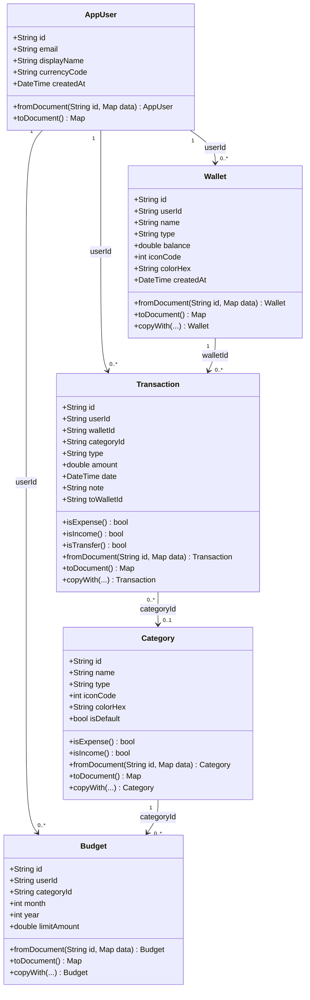
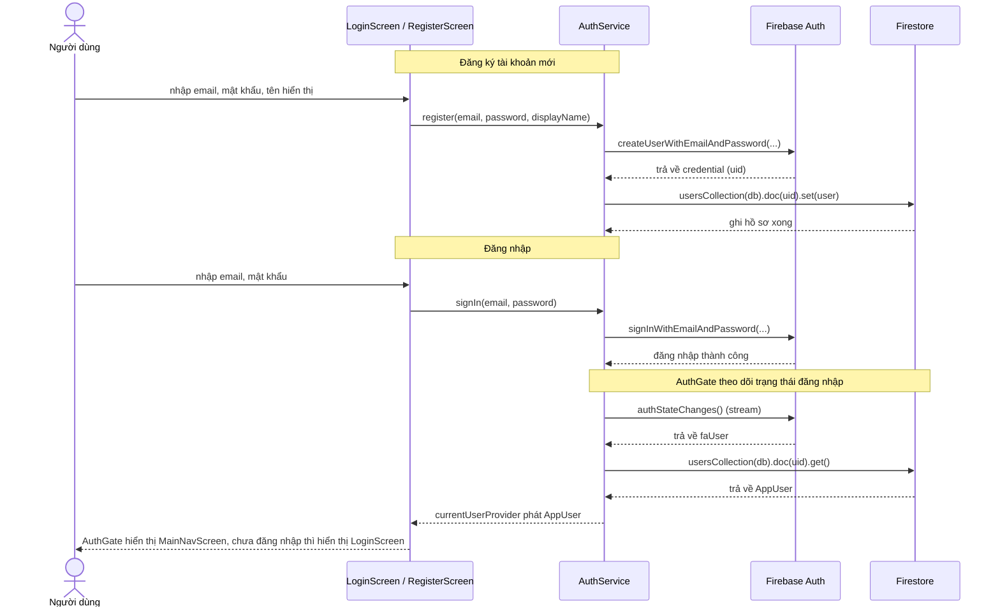
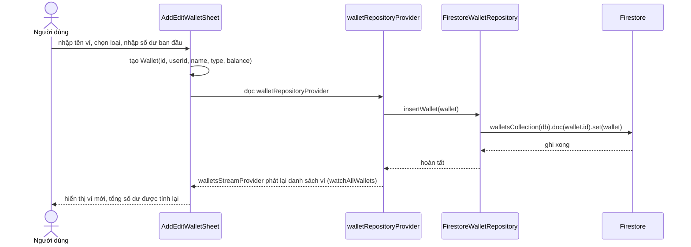
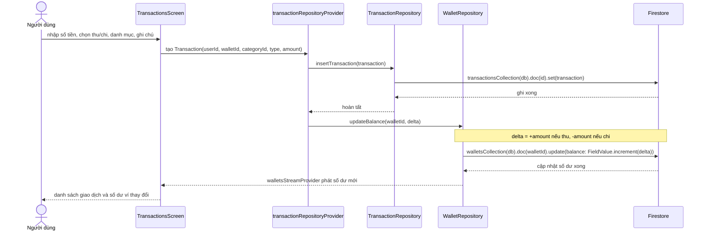
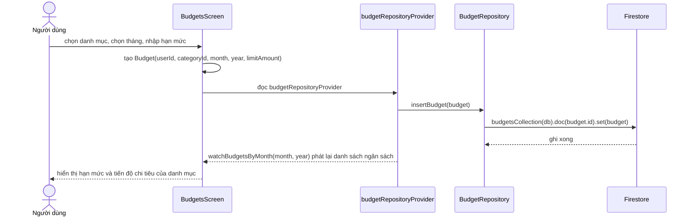
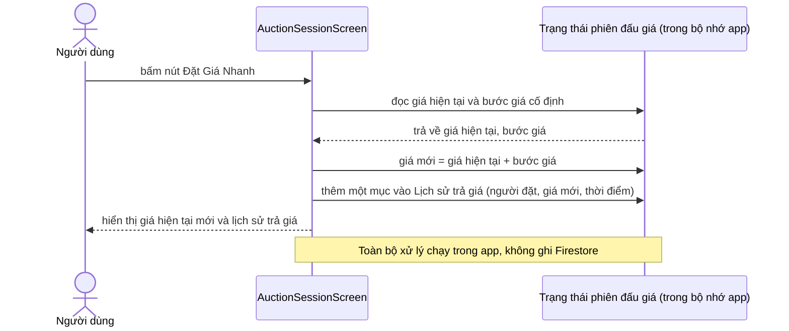

# Sơ đồ thiết kế (Câu 3)

Tài liệu này mô tả cấu trúc lớp và các luồng hoạt động chính của ứng dụng. Tên lớp, thuộc tính và phương thức trong sơ đồ lớp lấy đúng theo code trong thư mục `lib/data/firestore/models`. Các sơ đồ tuần tự vẽ theo luồng xử lý trong `lib/features`.

## 1. Sơ đồ lớp (Class Diagram)

Giải thích quan hệ trong sơ đồ:

- **AppUser 1 - 0..\* Wallet**: một người dùng có nhiều ví, mỗi ví thuộc đúng một người dùng qua `userId`.
- **AppUser 1 - 0..\* Transaction**: một người dùng tạo nhiều giao dịch, mỗi giao dịch có đúng một `userId`.
- **AppUser 1 - 0..\* Budget**: một người dùng đặt nhiều ngân sách, mỗi ngân sách có đúng một `userId`.
- **Wallet 1 - 0..\* Transaction**: một ví có nhiều giao dịch, mỗi giao dịch gắn với đúng một ví qua `walletId`. Số dư ví được cập nhật mỗi khi giao dịch thay đổi.
- **Transaction 0..\* - 0..1 Category**: `categoryId` có thể null nên một giao dịch có thể không có danh mục; một danh mục có nhiều giao dịch.
- **Category 1 - 0..\* Budget**: một danh mục có thể có ngân sách cho nhiều tháng, mỗi ngân sách gắn với đúng một danh mục.
- Giao dịch chuyển khoản còn tham chiếu thêm một ví nữa qua `toWalletId` (ví nhận tiền), không vẽ thêm đường nối để sơ đồ đỡ rối.

Các interface repository (`WalletRepository`, `TransactionRepository`, `CategoryRepository`, `BudgetRepository`) nằm trong `lib/features`, không phải class dữ liệu nên không đưa vào sơ đồ lớp trên; phương thức của chúng đã liệt kê ở phần phân tích Câu 2.

## 2. Sơ đồ tuần tự (Sequence Diagram)

### 2.1. Đăng ký và đăng nhập

### 2.2. Tạo ví mới

### 2.3. Thêm giao dịch và cập nhật số dư ví

### 2.4. Đặt ngân sách tháng

### 2.5. Tham gia phiên đấu giá

